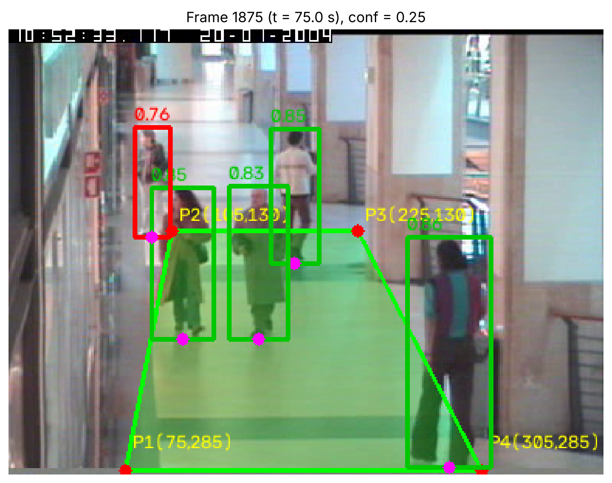
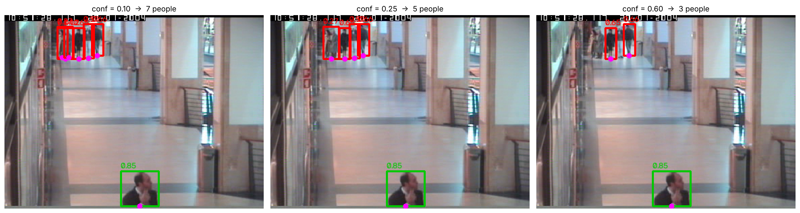
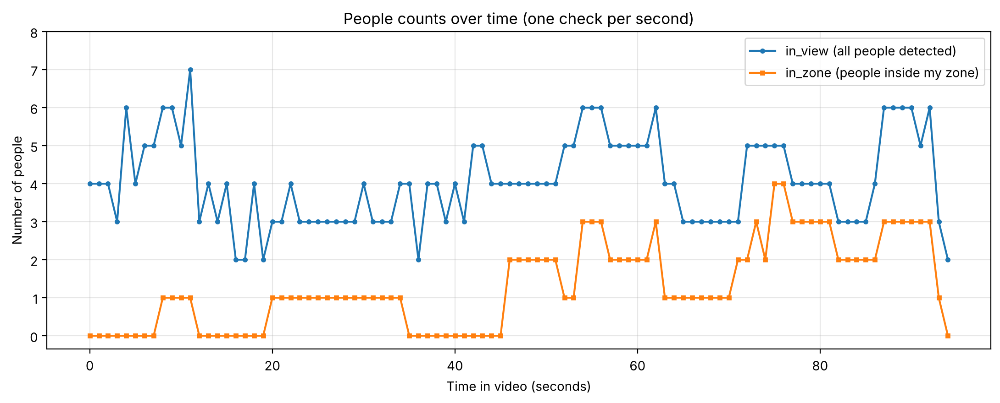

# YOLO Mall Corridor Monitoring

## About
This is a class project from CSIT3110 / DSCI5420 at Graceland University (Assignment 10, Object Detection Using YOLO). The goal was to use a pretrained object detector on real video and turn the detections into something a mall manager could use. I picked a zone on the corridor floor, counted how many people were inside it each second, and plotted how crowded it got over the clip.

## What it does
- Loads a 94 second corridor clip and samples one frame per second
- Detects people with YOLO26n (confidence threshold 0.25, chosen by comparing 0.10, 0.25 and 0.60)
- Counts people in view and people inside a custom polygon zone, using the bottom centre of each bounding box (the feet) for the zone test
- Saves per second counts to `data/mall_records.csv` and plots them over time

## Results
- 95 one second checks, zone occupied in 67 of them
- Mean zone count 1.31, mean in view 4.06, peak zone count 4 at t = 75 s and 76 s
- Per second snapshots measure crowding, not unique shoppers (no tracking across frames)

## Output
Annotated frame at t = 75 s (green = inside zone, red = outside, magenta = bottom centre point used for the zone test):



Confidence threshold comparison (0.10, 0.25, 0.60) on one frame:



People counts per second:



## Run it
```bash
pip install -r requirements.txt
# put mall_corridor.mpg next to the notebook (video not included)
jupyter notebook mall_corridor_monitoring.ipynb
```
The model weights (`yolo26n.pt`) download automatically on first run.

## Files
- `mall_corridor_monitoring.ipynb`: full analysis with outputs
- `data/mall_records.csv`: time_s, in_view, in_zone
